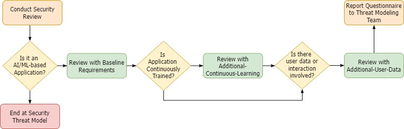
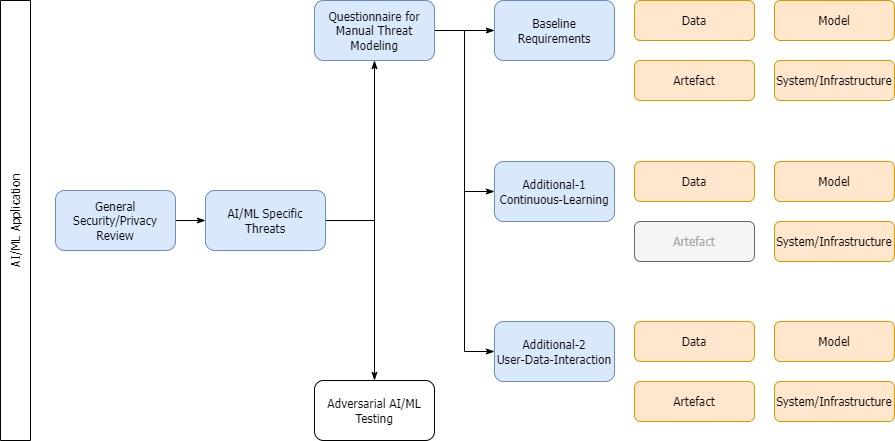

AI Threat Modeling Solution  
<i><b>Questionnaire to identify threats in AI/ML applications </b></i> 
Developed by the Comcast SPIDER Team

# Contents
- [Project GuardRail](#project-guardrail)
- [Quickstart](#quick-start)
- [Who Can Benefit](#who-can-benefit)
- [Purpose](#purpose)
- [How](#how)
- [Structure](#structure)
- [Publications](#publications)
- [Talks](#talks)
- [External Visibility](#external-visibility)
- [Roadmap](#roadmap)
- [Sources](#sources)
- [Contributions](#contributions)
- [License](#license)

<!--## Contents
- [Overview](#overview)
- [Structure](#structure)
- [Usage](#usage)
- [Publications](#publications)
- [Talks](#talks)
- [External Visibility](#external-visibility)
- [Roadmap](#roadmap)
- [Sources](#sources)
- [Contributions](#contributions)
- [License](#license) -->

# Project GuardRail

Project GuardRail is a comprehensive security framework that focuses on AI risk assessment across the entire lifecycle of AI applications. It is specifically designed to address the unique security risks faced by AI/ML applications. It provides a questionnaire-based approach to identify and assess potential risks associated with AI technologies, enabling organizations to make informed decisions and implement appropriate risk mitigation measures. It can be integrated at any phase of the secure development lifecycle, allowing for continuous assessment and improvement of AI applications.

<!--Project GuardRail is a comprehensive security framework specifically designed to address the unique security threats faced by AI/ML applications. It provides a questionnaire-based approach to threat modeling, ensuring that security and privacy requirements are met during the design phase. By acting as guardrails, Project GuardRail helps protect AI/ML applications against these threats.

Project GuardRail is a comprehensive security framework that focuses on AI risk assessment across the entire lifecycle of AI applications. It provides a structured approach to identify and assess potential risks associated with AI technologies, enabling organizations to make informed decisions and implement appropriate risk mitigation measures.-->

<!-- ## Overview

AI/ML applications have unique security threats. Project GuardRail provides a questionnaire that includes a set of threat modeling questions for AI/ML applications. It helps ensure to meeting security and privacy requirements during the design phase, which serve as guardrails against those threats. The requirements help scope the threats to protect AI/ML applications against. It consists of a baseline set required for **all** AI/ML applications and two additional set of requirements that are specific to **continuous learning** and **user-interacting** models. There are four additional questions that are specific to generative AI applications only. -->

# Quick Start

To quickly get started with Project GuardRail, follow these steps:

1. Familiarize yourself with the questionnaire on [this page](https://github.com/Comcast/ProjectGuardRail/tree/main/Questionnaire) and its structure.
2. Determine the appropriate phase of the secure development lifecycle to incorporate AI risk assessment.
3. Assess your AI application against the relevant risk assessment criteria provided by Project GuardRail.
4. Implement the recommended risk mitigation measures and best practices based on the assessment results.

<!--To quickly get started with Project GuardRail, follow these steps:

1. Familiarize yourself with the threat modeling questionnaire and its structure.
2. Determine the category that your AI/ML application falls into: baseline, continuous learning, user-interacting, or generative AI.
3. Assess your application against the relevant set of requirements outlined in the questionnaire. -->

# Who Can Benefit?
Project GuardRail is beneficial for 
- developers,
- data scientists,
- security professionals,
- project managers,
- and organizations involved in the development and deployment of AI applications, including third-party AI vendors.

It provides comprehensive guidance and a structured approach to assess AI risks, ensuring the implementation of appropriate security measures and adherence to necessary security and privacy requirements throughout the application's lifecycle.

<!--Project GuardRail is beneficial for developers, data scientists, security professionals, and project managers involved in the development and deployment of AI applications. It provides guidance and tools to aid in the assessment of AI risks, ensuring that appropriate security measures are implemented throughout the application's lifecycle.

Project GuardRail is beneficial for developers and organizations working on AI/ML applications, as well as third-party AI vendors. It provides a structured approach to assess and address security threats, ensuring that AI/ML applications meet the necessary security and privacy requirements. -->

# Purpose

The purpose of Project GuardRail is to enable organizations to conduct comprehensive AI risk assessments at any phase of the AI application's lifecycle. This helps ensure potential security and privacy risks are identified and any relevant considerations are integrated from the early design phase.
By identifying potential risks and vulnerabilities, Project GuardRail empowers organizations to make informed decisions regarding the security, privacy, and ethical considerations of their AI applications. By applying the [baseline](Questionnaire/baseline.md) and additional requirements ([additional1](Questionnaire/additional1.md) and [additional2](Questionnaire/additional2.md)) specific to different AI/ML application types, Project GuardRail helps scope and address the risks that these applications may face.

<!--The purpose of Project GuardRail is to enable organizations to conduct comprehensive AI risk assessments at any phase of the AI application's lifecycle. By identifying potential risks and vulnerabilities, Project GuardRail empowers organizations to make informed decisions regarding the security, privacy, and ethical considerations of their AI applications.

The purpose of Project GuardRail is to guide the threat modeling process for AI/ML applications, ensuring that security and privacy considerations are integrated from the early design phase. By applying the baseline and additional requirements specific to different AI/ML application types, Project GuardRail helps scope and address the threats that these applications may face.-->

## Use Cases

  

<!---->
<!---->

- Secure Development: Project GuardRail enables developers to conduct AI risk assessments and incorporate security measures throughout the development process, ensuring that AI applications are built with a strong focus on security, privacy, and ethical considerations.
- Compliance and Regulations: Organizations can leverage Project GuardRail to assess AI applications against industry-specific regulations and compliance requirements, ensuring adherence to data protection, privacy, and security standards.
- Third-Party AI Vendors: Project GuardRail provides a structured approach for organizations to assess the security posture of AI solutions offered by third-party vendors, enabling informed decision-making and ensuring the selection of secure and reliable AI technologies.
- Continuous Monitoring: By integrating Project GuardRail into the ongoing monitoring and maintenance of AI applications, organizations can proactively identify and address emerging risks, ensuring the ongoing security and integrity of their AI systems.
- Risk Mitigation: Project GuardRail aids in identifying potential risks and vulnerabilities associated with AI technologies, allowing organizations to implement appropriate risk mitigation strategies and controls to protect against potential threats.
- Ethical AI Development: Project GuardRail assists organizations in considering ethical implications and promoting responsible AI development by incorporating guidelines and assessments for fairness, transparency, and bias mitigation.

# How?
Project GuardRail provides a risk assessment questionnaire derived from various frameworks and sources. The questionnaire consists of baseline requirements applicable to all AI/ML applications, additional requirements for continuous learning and user-interacting models, and specific questions for generative AI applications. Each requirement is categorized into data, model, artefact, and system/infrastructure, based on the element of the ML application to which the threat is relevant. This questionnaire can be used as an assessment for both AI/ML applications as well as new third-party AI vendors. 

After an application undergoes the usual security review process and it is determined that it is not an AI/ML-driven application, the review ends. Otherwise, the application developers can take the baseline assessment. Following this, depending on whether the underlying model fits into the two additional categories outlined above, additional assessment questions can be added. This questionnaire can then be reported to the threat modeling team for review. 

To use Project GuardRail, assess your AI application against the provided risk assessment criteria, considering factors such as data handling, model robustness, privacy protection, and ethical considerations. Based on the assessment results, implement the recommended risk mitigation measures and best practices to enhance the security and reliability of your AI application.

# Structure
The content of this library is derived from a variety of frameworks, lists, and sources, both from academia and industry. We have performed several iterations to refine the library to accurately determine the scope and language of the questions. The [sources](#sources) provided below offer a comprehensive list of all the materials contributing to this library. 

As shown in the diagram below, the "Questionnaire for Manual Threat Modeling" defines the library. The 53 threats (and 4 additional generative AI threats) are divided into three categories as shown. 

- All AI/ML applications must meet the 28 [baseline](./baseline.md) requirements.   
- If an application is continuously learning, it must meet 6 [additional](./additional-1.md) requirements in addition to the baseline.
- If an application EITHER trains on user data OR interacts with users, it must meet 19 [additional](./additional-2.md) requirements.

Generative AI questions are differentiated and put into a separate group under each category if applicable.

Each requirement is divided into four sub categories - data, model, artefact (output), and system/infrastructure, depending on the element of the ML application to which a threat is applicable. 

<b>Data</b> indicates all input information to the model that it trains on. <b>Model</b> indicates the source code of the AI/ML application. <b>Artefact</b> indicates the output of the model, including predictions if applicable. <b>System/infrastructure</b> is the underlying architecture supporting the model functionality, like hardware, for example. 

<!--## Usage
This threat modeling questionnaire can be used as an assessment for both AI/ML applications as well as new third-party AI vendors. After an application undergoes the usual security review process and it is determined that it is not an AI/ML-driven application, the review ends. Otherwise, the application developers can take the baseline assessment. Following this, depending on whether the underlying model fits into the two additional categories outlined above, additional assessment questions can be added. This questionnaire can then be reported to the threat modeling team for review. 

 -->

# Publications
Jayati Dev, Nuray Baltaci Akhuseyinoglu, Golam Kayas, Bahman Rashidi, Vaibhav Garg. [Building Guardrails in AI Systems with Threat Modeling](https://dl.acm.org/doi/abs/10.1145/3674845). Digital Government: Research and Practice (2024).

# Talks
Nuray Baltaci Akhuseyinoglu. AI Under the Hood: Unmasking Hidden Threats. [OWASP LASCON 2024](https://lascon.org/past-lascon-2024/).

Nitish Uplavikar. AI Under the Hood: Unmasking Hidden Threats. [OWASP AppSec 2024](https://owasp2024globalappsecsanfra.sched.com/2024-09-27/overview).

Yasmine Abdillahi, Jayati Dev. AI Risk Management: Adopt and Scale AI Threat Modeling. Executive Women’s Forum.  (2023)

# External Visibility

[NIST AI Risk Management Framework Playbook](https://airc.nist.gov/AI_RMF_Knowledge_Base/Playbook/Measure#:~:text=MEASURE-,2.7,-AI%20system%20security), Measure 2.7(2024)

[OECD Catalogue of Tools & Metrics for Trustworthy AI](https://oecd.ai/en/catalogue/tools/project-guardrail)(2023) 

# Roadmap
Roadmap information is available in [CONTRIBUTION ROADMAP.md](CONTRIBUTION-ROADMAP.md).

# Contributions 
Contributions and suggestions from the open-source community are welcome. Please refer to the [Contributing.md](CONTRIBUTING.md) document for more information. All contributions must follow the [Comcast Code of Conduct](CODE_OF_CONDUCT.md).

# Sources
- Plot4AI: https://plot4.ai/ 
- NIST AI Risk Management Framework 1.0: https://www.nist.gov/itl/ai-risk-management-framework 
- ETSI GR SAI 004: https://www.etsi.org/deliver/etsi_gr/SAI/001_099/004/01.01.01_60/gr_SAI004v010101p.pdf
- Mauri & Damiani, Modeling Threats to AI-ML Systems Using STRIDE: https://www.mdpi.com/1424-8220/22/17/6662, https://github.com/LaraMauri/STRIDE-AI 
- Microsoft AI/ML Threat Modeling: https://learn.microsoft.com/en-us/security/engineering/threat-modeling-aiml#11-exploit-software-dependencies-of-the-ml-system
- Microsoft + Harvard Failure Modes in Machine Learning https://learn.microsoft.com/en-us/security/engineering/failure-modes-in-machine-learning 
- Gebru et al., Datasheets for Datasets: https://arxiv.org/abs/1803.09010
- Amershi et al., Guidelines for Human-AI Interaction: https://dl.acm.org/doi/10.1145/3290605.3300233
- Kotenko et al., Attacks Against Artificial Intelligence Systems: Classification, The Threat Model and the Approach to Protection: https://link.springer.com/chapter/10.1007/978-3-031-19620-1_28
- MITRE ATLAS: https://atlas.mitre.org/

This repository will be updated as we use additional sources to update the library if required. 

# License

Licensed under the [CC-BY-4.0](https://creativecommons.org/licenses/by/4.0/) license.

# Contents
- [Project GuardRail](#project-guardrail)
- [Quickstart](#quick-start)
- [Who Can Benefit](#who-can-benefit)
- [Purpose](#purpose)
- [How](#how)
- [Structure](#structure)
- [AI Adversarial Threat & Robustness Tool Mapping](#ai-adversarial-threat--robustness-tool-mapping)
- [Publications](#publications)
- [Talks](#talks)
- [External Visibility](#external-visibility)
- [Roadmap](#roadmap)
- [Sources](#sources)
- [Contributions](#contributions)
- [License](#license)

# AI Adversarial Threat & Robustness Tool Mapping

This section maps common AI adversarial threats and vulnerabilities to relevant robustness tools and corresponding GuardRail questions. The goal is to provide practitioners with a clear guide on how to identify threats using GuardRail and which tools can be leveraged to test or mitigate these risks. It also highlights potential gaps and areas for future enhancement in both tools and GuardRail questions.

## Understanding the Mapping

The table below provides a structured overview of known adversarial threats, the tools available to address them, and specific GuardRail questions that help assess an AI system's resilience.

| Adversarial Threat/Vulnerability | Relevant Robustness Tools | GuardRail Questions (References) | Tool Capabilities/Limitations | Suggested Enhancements/Gaps |
|----------------------------------|---------------------------|----------------------------------|-------------------------------|-----------------------------|
|                                  |                           |                                  |                               |                             |

## How to Contribute

We welcome contributions to enhance this table. If you'd like to add a new threat, suggest a tool, or improve existing information, please follow these guidelines:

1.  **Fork the Repository:** Begin by forking the [Project GuardRail repository](https://github.com/Comcast/ProjectGuardRail).
2.  **Create a New Branch:** Create a new branch for your contributions (e.g., `feat/add-threat-mapping-X`).
3.  **Edit `README.md`:** Navigate to the "AI Adversarial Threat & Robustness Tool Mapping" section within `README.md`.
4.  **Add/Update Table Entries:**
    *   **New Threats/Vulnerabilities:** Add a new row for any unlisted adversarial threats, providing a concise definition.
    *   **Relevant Robustness Tools:** List specific tools that can address or test against the threat. Include links to official documentation or repositories where possible.
    *   **GuardRail Questions:** Identify any existing GuardRail questions that evaluate resilience against the threat. Provide direct links to the relevant line in the questionnaire files (e.g., `Questionnaire/baseline.md#LXX`). If no suitable question exists, note this as a gap and consider proposing a new question (see below).
    *   **Tool Capabilities/Limitations:** Briefly describe the strengths and weaknesses of the listed tools in the context of the specific threat.
    *   **Suggested Enhancements/Gaps:** Propose ideas for improving existing tools, identifying needs for new tools, or suggesting missing GuardRail questions for comprehensive coverage.
5.  **Propose New GuardRail Questions (If Needed):** If you identify a threat not adequately covered by existing GuardRail questions, please open an issue in the repository to propose new questions. Refer to `CONTRIBUTING.md` for general guidelines on suggesting new questionnaire content.
6.  **Submit a Pull Request:** Once your changes are complete, submit a pull request to the `main` branch of the Project GuardRail repository. Please provide a clear description of your contributions in the PR.

For general contribution guidelines, please refer to the main [CONTRIBUTING.md](CONTRIBUTING.md) document. We appreciate your contributions to making Project GuardRail a more robust and helpful resource!